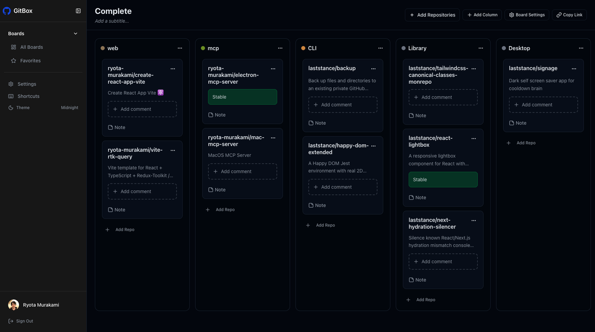

# GitBox

[](https://codecov.io/gh/laststance/gitbox)
[](https://github.com/laststance/gitbox/actions/workflows/e2e.yml)
[](https://github.com/laststance/gitbox/actions/workflows/e2e.yml)
[](https://github.com/laststance/gitbox/actions/workflows/build.yml)
[](https://github.com/laststance/gitbox/actions/workflows/test.yml)
[](https://github.com/laststance/gitbox/actions/workflows/lint.yml)

GitBox is a web app for organizing your scattered GitHub repositories in Kanban-style boards—perfect for managing the chaos of Vibe Coding projects and beyond.

- Live app: https://gitbox-laststance.vercel.app



## Why?

Because let's be honest—GitHub's repository list is kind of a mess 😅

When you have dozens (or hundreds) of repos from side projects, experiments, and Vibe Coding sessions, finding what you need becomes a treasure hunt. GitBox lets you visually organize everything in customizable Kanban boards, so you can finally bring order to the chaos.

## Features

- Kanban boards for GitHub repositories
- Drag-and-drop organization (cards, columns, boards)
- Move cards between boards
- Set repositories aside on a board of their own, notes and links kept
- A repository keeps its note, links and comment when its card is removed, and the Add Repositories picker marks what is saved
- GitHub OAuth-based access
- Supabase-backed persistence with RLS
- Rich text project notes (Plate.js editor)
- Project info links (55 built-in types + custom presets)
- Inline comments on repo cards with color customization
- Inline editable board title and subtitle
- Private boards: a board opens only for the account that owns it
- 14 themes (7 light + 7 dark) + system preference
- Collapsible sidebar with state persistence
- Command palette (⌘K)
- Rate limiting and security headers
- PWA-friendly experience

## Tech Stack

- **Framework**: Next.js 16 (App Router)
- **UI**: React 19.3, Tailwind CSS 4, shadcn/ui
- **State**: Redux Toolkit + @laststance/redux-storage-middleware
- **Database**: Supabase (PostgreSQL + Auth + RLS)
- **Rich Text**: Plate.js (Platejs 53)
- **Drag & Drop**: @dnd-kit
- **Validation**: Zod 4
- **Monitoring**: Sentry 11
- **Testing**: Playwright 1.63 (E2E), Vitest 5 (Unit), Storybook 10

## Getting Started

### Prerequisites

- Node.js >=24.12.0
- pnpm 11.1.2 (the `packageManager` field of `package.json`)
- Docker Desktop, running (it hosts the local Supabase)
- A GitHub account, to register the OAuth App that signs you in

### Setup

Follow the steps in this order. `pnpm db:start` reads `supabase/.env`, so the OAuth App and that file come first.

1. Install dependencies:

   ```bash
   pnpm install
   ```

2. Register a GitHub OAuth App at https://github.com/settings/developers:

   - Application name: `GitBox Local Dev`
   - Homepage URL: `http://localhost:3008`
   - Authorization callback URL: `http://127.0.0.1:54321/auth/v1/callback`

   Then copy its client ID and generate a client secret.

3. Create `supabase/.env` with that client ID and secret. The Supabase CLI reads OAuth credentials from this file, not from the root `.env`:

   ```bash
   GITHUB_CLIENT_ID="your-github-oauth-client-id"
   GITHUB_CLIENT_SECRET="your-github-oauth-client-secret"
   ```

4. Start local Supabase. The script loads `supabase/.env` and applies every migration:

   ```bash
   pnpm db:start
   ```

5. Create the app's `.env` and replace its placeholders (the variables are described under [Environment Variables](#environment-variables)). The Supabase values come from the running local stack, the GitHub values are the ones from step 3:

   ```bash
   cp .env.local.example .env
   supabase status -o env
   ```

6. Start the dev server and open `http://localhost:3008` in your browser:

   ```bash
   pnpm dev
   ```

### Environment Variables

| Variable                        | Required | Description                                            |
| ------------------------------- | -------- | ------------------------------------------------------ |
| `NEXT_PUBLIC_SUPABASE_URL`      | ✅       | Supabase project URL                                   |
| `NEXT_PUBLIC_SUPABASE_ANON_KEY` | ✅       | Supabase anonymous key                                 |
| `SUPABASE_SERVICE_ROLE_KEY`     | ✅       | Supabase service role key (server-only)                |
| `GITHUB_CLIENT_ID`              | ✅       | GitHub OAuth App client ID (in `supabase/.env`)        |
| `GITHUB_CLIENT_SECRET`          | ✅       | GitHub OAuth App client secret (in `supabase/.env`)    |
| `NEXT_PUBLIC_SITE_URL`          | ✅       | Site URL for OAuth callbacks                           |
| `SENTRY_AUTH_TOKEN`             | ❌       | Sentry authentication token (optional)                 |
| `APP_ENV`                       | ❌       | Environment mode (`development`, `test`, `production`) |
| `NEXT_PUBLIC_ENABLE_MSW_MOCK`   | ❌       | Enable MSW mocking for tests                           |
| `BOARD_TIMING_LOG`              | ❌       | Opt-in `/board/[id]` server-side timing logs (off)     |

**Vercel Environment Variables:**

When deploying to Vercel, the following are auto-injected:

- `VERCEL_ENV` - Current deployment environment
- `VERCEL_URL` - Deployment URL

### Running the Local Supabase

Run the local stack through the package scripts, never a bare `supabase start` or `supabase stop`: `pnpm db:start` and `pnpm db:reset` load `supabase/.env` first.

```bash
# Start (applies every migration)
pnpm db:start

# Stop when done
pnpm db:stop

# Restart, after adding or changing supabase/.env
pnpm db:stop && pnpm db:start

# Reset the database (re-apply all migrations)
pnpm db:reset

# Check status and credentials
supabase status
```

**Local URLs:**

- Studio: http://127.0.0.1:54323
- API: http://127.0.0.1:54321

## Scripts

- `pnpm dev` - Start dev server (port 3008)
- `pnpm build` - Production build
- `pnpm start` - Start production server (port 3008)
- `pnpm lint` - ESLint (zero warnings)
- `pnpm typecheck` - TypeScript type check
- `pnpm test` - Unit tests (Vitest)
- `pnpm e2e` - E2E tests (Playwright, sequential)
- `pnpm e2e:parallel` - E2E tests (parallel shards, recommended)
- `pnpm storybook` - Storybook dev server (port 6006)
- `pnpm db:start` - Start local Supabase (Docker)
- `pnpm db:stop` - Stop local Supabase
- `pnpm db:reset` - Reset local database

## Security

See `SECURITY.md`.

## License

MIT. See `LICENSE`.
